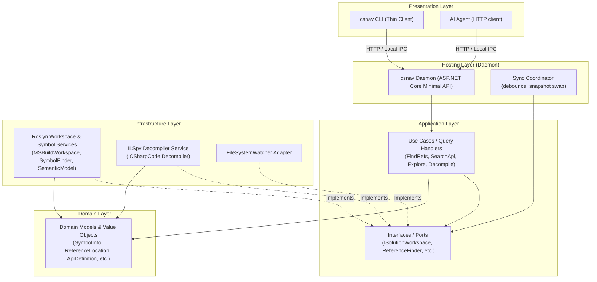
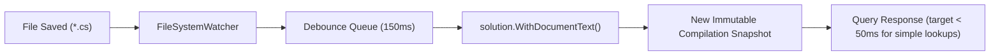

# Pmad CSharpNav (`csnav`) - Architecture & Design Specification

## 1. System Overview

**Pmad.CSharpNav** (`csnav`) is a high-performance, machine-oriented navigation and analysis engine designed for AI coding agents and developers working with C# codebases. It provides deterministic, token-efficient, and structured representations (JSON/Markdown) of C# code, dependencies, symbols, and decompiled assemblies.

### Key Goals
1. **Low Latency for AI Agents**: Cold-starting Roslyn MSBuild workspaces takes 5–15+ seconds. `csnav` runs as a background daemon per solution/workspace, maintaining an in-memory compilation state that updates incrementally in milliseconds when files change.
2. **Token Efficiency**: Outputs are strictly formatted for LLM context windows—compact, structured JSON with pagination, context snippets, and omission of null/boilerplate fields.
3. **Clean Architecture**: Domain entities and Application use cases are free of Roslyn/ILSpy types. Only Infrastructure (Roslyn & ILSpy adapters) references them. Server hosting (Daemon) and Presentation (CLI) are separate projects.
4. **Rich Semantic Capabilities**:
   - **Search for References**: Find usages of types, constructors, methods, properties, and interface implementations.
   - **Search for APIs**: Query symbols across local source code and referenced libraries (NuGet & BCL) by name and XML documentation.
   - **Explore Members**: Inspect class/variable members, hierarchies, signatures, and docstrings (Object Explorer / IntelliSense for AI).
   - **Decompile External Code**: Decompile classes or individual methods from external NuGet/BCL assemblies into clean C# source.
5. **First-Class Razor & CSHTML Support**:
   - Transparently navigate Blazor components (`.razor`) and ASP.NET Core views/pages (`.cshtml`).
   - Uses Roslyn's native source generator pipeline and mapped line span (`#line`) directives to translate symbol locations, definitions, implementations, and call sites directly back to the original `.razor` and `.cshtml` files on disk with accurate 1-indexed lines and character columns.


---

## 2. High-Level Architecture

The system follows **Clean Architecture** (Ports and Adapters / Onion Architecture) with a Client-Server topology:



---

## 3. Layer Breakdown & Project Structure

The solution is divided into distinct projects adhering to the Dependency Rule (dependencies point strictly inward):

```text
src/
├── Pmad.CSharpNav.Domain/           # Pure enterprise & code navigation models (No dependencies)
├── Pmad.CSharpNav.Application/      # Use cases, queries, port interfaces, DTOs
├── Pmad.CSharpNav.Infrastructure/   # Roslyn MSBuild, ILSpy, FileWatcher implementations
├── Pmad.CSharpNav.Contracts/        # Request/response JSON contracts shared by Server and Cli (versioned)
├── Pmad.CSharpNav.Server/           # Daemon process, composition root, local HTTP server, lifecycle manager
└── Pmad.CSharpNav.Cli/              # Thin client CLI executable (depends on Contracts only; auto-starts daemon)
tests/
├── Pmad.CSharpNav.Domain.Tests/
├── Pmad.CSharpNav.Application.Tests/
├── Pmad.CSharpNav.Infrastructure.Tests/
└── Pmad.CSharpNav.IntegrationTests/
```

### 3.1. `Pmad.CSharpNav.Domain`
Pure domain layer. Has **zero dependencies** on Roslyn, ILSpy, ASP.NET, or CLI libraries.

* **Domain Models / Value Objects**:
  - `SymbolIdentifier`: Represents a unique symbol reference (containing assembly, namespace, type, member signature, or symbol ID).
  - `SymbolKind`: Enum (`Class`, `Interface`, `Struct`, `Record`, `Enum`, `Method`, `Property`, `Field`, `Event`, `Constructor`, `Delegate`, `Namespace`, `Parameter`, `Local`).
  - `Accessibility`: Enum (`Public`, `Internal`, `Protected`, `Private`, `ProtectedInternal`, `PrivateProtected`).
  - `ReferenceLocation`: File path, line/column range, context snippet, containing member, reference kind (`Invocation`, `Instantiation`, `Read`, `Write`, `TypeReference`, `Override`, `Implementation`), `isGenerated` flag.
  - `ApiDefinition`: Symbol signature, XML doc summary, parameters, returns, remarks, assembly/project origin.
  - `TypeMemberInfo`: Member name, kind, signature, accessibility, modifiers (`static`, `abstract`, `virtual`, `override`), XML doc, return type.
  - `TypeHierarchy`: Base classes, implemented interfaces, derived types.
  - `DecompiledSource`: Source code string, target framework, assembly metadata, source language level.

### 3.2. `Pmad.CSharpNav.Application`
Defines business rules, orchestrates data flow, and declares port interfaces.

* **Ports (Interfaces)**:
  - `ISolutionWorkspace`: Manages current solution state, projects and document updates. Exposes opaque, immutable `IWorkspaceSnapshot` handles. Roslyn `Solution`/`Compilation` types stay inside Infrastructure.
  - `IReferenceFinder`: Finds references and callers for symbols or source positions.
  - `IApiSearchEngine`: Performs pattern-based and full-text XML documentation searches across solution source and external references.
  - `ITypeExplorer`: Inspects type declarations, members, hierarchies, and evaluates variable types at positions.
  - `IAssemblyDecompiler`: Resolves assembly binaries and decompiles requested types or members.
  - `ICompilationUpdater`: Incremental updater receiving file system change events.
  - **Rule**: all ports accept and return Domain types or primitives only (never `ISymbol`, `SemanticModel`, `Compilation`, `EntityHandle`). Every query takes an `IWorkspaceSnapshot` (see section 5.5).
* **Queries & Handlers**:
  - `FindReferencesQuery` / `FindReferencesHandler`
  - `SearchApiQuery` / `SearchApiHandler`
  - `ExploreTypeQuery` / `ExploreTypeHandler`
  - `DecompileMemberQuery` / `DecompileMemberHandler`
  - `GetWorkspaceStatusQuery` / `GetWorkspaceStatusHandler`
  - `SyncDocumentQuery` / `SyncDocumentHandler`

### 3.3. `Pmad.CSharpNav.Infrastructure`
Contains the concrete adapters implementing Application ports:

* **Roslyn Implementations**:
  - `RoslynSolutionWorkspace`: Wraps `MSBuildWorkspace`. Loads `.sln` or `.csproj`. Maintains the immutable `Solution` and current `Compilation` references. Synchronizes standard `.cs` documents as well as `.razor` and `.cshtml` files as `AdditionalDocument`s (`Solution.WithAdditionalDocumentText`, `AddAdditionalDocument`, `RemoveAdditionalDocument`).
  - `RoslynWorkspaceSnapshot`: Provides atomic snapshot isolation. Ensures Roslyn source generators (such as the Razor compiler source generator) execute via `project.GetSourceGeneratedDocumentsAsync()` when analyzer references exist, and provides helpers for additional document lookups and `#line` directive tree mapping.
  - `RoslynReferenceFinder`: Uses `Microsoft.CodeAnalysis.FindSymbols.SymbolFinder` to resolve references, constructors, call sites, and interface implementations across projects. Translates locations using `Location.GetMappedLineSpan()` so that symbols declared or referenced in `.razor` and `.cshtml` files map to their real file paths, 1-indexed line/column positions, and code snippets extracted directly from disk rather than generated `.g.cs` files (clearing `isGenerated` for mapped user files). Also supports reverse lookup (`ResolveSymbolInMappedFileAsync`) when resolving queries targeting positions inside `.razor` / `.cshtml` files.
  - `RoslynApiSearchEngine`: Uses `SymbolFinder.FindSourceDeclarationsAsync` and cached external metadata symbols (`IAssemblySymbol.GlobalNamespace`) with an inverted index for fast keyword/XML doc lookups.
  - `RoslynTypeExplorer`: Resolves `INamedTypeSymbol` or infers types via `SemanticModel.GetTypeInfo()` / `GetSymbolInfo()`.
  - `RoslynMetadataResolver`: Maps an external assembly symbol or name to its physical `.dll` location (via `Compilation.GetMetadataReference`, NuGet global cache, or runtime packs).
* **Decompiler Implementation**:
  - `ILSpyDecompiler`: Uses `ICSharpCode.Decompiler.CSharp.CSharpDecompiler`. Supports decompiling an entire type or extracting a single method/property definition using `EntityHandle`.
* **File System & Caching**:
  - `DebouncedFileWatcher`: Monitors directory for `.cs`, `.razor`, `.cshtml`, `.csproj`, `.sln`/`.slnx`, `Directory.Build.*`, `Directory.Packages.props` and `.editorconfig` changes. Ignores `bin/` and `obj/`. Dispatches debounced update events (changed, added, deleted, renamed).

### 3.4. `Pmad.CSharpNav.Server` (Daemon Host)
A lightweight background host process running on `localhost`.

* **Web Host**: ASP.NET Core Minimal API listening on a loopback ephemeral port (v1 transport: HTTP over `127.0.0.1`; named pipes / Unix sockets are a possible later option).
* **Startup**: `MSBuildLocator.RegisterDefaults()` must be called before any Roslyn MSBuild type is loaded. The .NET SDK must be installed on the machine.
* **Daemon Management**:
  - Manages single-instance lifecycle per solution.
  - Discovery metadata written to the discovery file described in section 5.4 (port, PID, solution path, token).
  - Configurable idle timeout (e.g., auto-shutdown after 30 minutes of inactivity).
  - Background initialization with progress reporting.

### 3.5. `Pmad.CSharpNav.Cli` (Presentation)
A thin, fast CLI client built with `System.CommandLine`.

* **Role**:
  1. Inspects the target directory / solution.
  2. Checks if a daemon is running via the discovery file (section 5.4).
  3. If not running, launches the daemon process in background (`csnav server start`) and waits for health readiness.
  4. Sends the request via HTTP/IPC.
  5. Outputs the result to `stdout` (JSON by default, or readable text/markdown). All logs/status go to `stderr`.

---

## 4. Core Features Specification

### 4.1. Feature 1: Search for References

Finds all usages of a symbol across the entire solution or specified projects.

#### Query Modes
1. **By Location**: Target symbol identified by `FilePath`, `Line`, and `Column` (e.g. cursor position).
2. **By Symbol Name / FQN**: Target symbol identified by name, e.g. `OrderService.PlaceOrder`, `Customer..ctor`, or `IRepository<T>.GetById`.

#### Capabilities & Mechanics
* **Constructors (`.ctor`)**: Can find all instantiations (`new Customer()`), base constructor calls (`base()`), and constructor initializer calls (`this()`).
* **Interfaces & Overrides**: Distinguishes between direct references, interface implementations, and virtual overrides (configurable via `--include-overrides` / `--include-implementations`).
* **Context Snippets**: Extracts 1–3 lines surrounding each reference with exact line and column numbers.
* **Reference Classification**: Labels each reference kind (`Invocation`, `Instantiation`, `Read`, `Write`, `TypeReference`, `Override`, `Implementation`).
* **Filtering**: `--exclude-tests` (skips projects referencing a test framework), `--project <name>`, `--framework <tfm>` (see section 8), `--include-generated`.
* **Pagination**: `--limit` (default 50) and `--offset`. Responses include `truncated` and `nextOffset` when more results exist.

#### LLM-Optimized Output Schema
```json
{
  "target": {
    "name": "PlaceOrder",
    "kind": "Method",
    "containingType": "Pmad.Commerce.OrderService",
    "definedIn": "src/Pmad.Commerce/OrderService.cs",
    "line": 42
  },
  "totalReferences": 2,
  "offset": 0,
  "limit": 50,
  "truncated": false,
  "references": [
    {
      "file": "src/Pmad.Commerce.Api/Controllers/OrderController.cs",
      "line": 28,
      "column": 32,
      "kind": "Invocation",
      "containingMember": "OrderController.CreateOrder",
      "isGenerated": false,
      "snippet": "var order = await _orderService.PlaceOrder(dto);"
    },
    {
      "file": "tests/Pmad.Commerce.Tests/OrderTests.cs",
      "line": 55,
      "column": 20,
      "kind": "Invocation",
      "containingMember": "OrderTests.TestPlaceOrder",
      "snippet": "await orderService.PlaceOrder(testDto);"
    }
  ]
}
```

---

### 4.2. Feature 2: Search for APIs (Codebase + Referenced Libraries)

Enables agents to discover types, methods, properties, and interfaces in the current codebase and external dependencies (NuGet packages and BCL).

#### Search Modes
1. **By Name / Wildcard**:
   - Exact: `CreateToken`
   - Prefix/Pattern: `*Repository`, `Add*`, `Jwt*`
   - Case-insensitive fuzzy or glob match.
2. **By Description / XML Doc**:
   - Full-text search over XML `<summary>`, `<param>`, and `<returns>` tags.
   - Example: Search `"jwt token expiration"` finds `JwtSecurityTokenHandler.ValidateToken`.
3. **Filtering**:
   - `--scope`: `all`, `source`, `dependencies`, or specific assembly name (e.g. `Microsoft.AspNetCore.Authentication`).
   - `--kind`: `class`, `interface`, `method`, `property`, `enum`, `record`.
   - `--access`: `public`, `internal`, `all`.
   - `--limit` / `--offset`: pagination (same semantics as references).
4. **CLI forms**: a positional argument is the name/wildcard pattern (`csnav api "Hash*"`); `--doc "<text>"` selects full-text XML doc search. `--query` is not used.

#### Architecture & Indexing Strategy
* **Source Symbols**: Leverages Roslyn's `SymbolFinder.FindSourceDeclarationsAsync`.
* **External Symbols**: Scans `Compilation.ExternalReferences`. On initial solution load, builds an in-memory lightweight index (Trie or inverted trigram index) of public metadata symbols and their XML documentation.
* **Lazy Documentation**: XML doc files (from NuGet `.xml` files or runtime directories) are parsed on-demand or indexed in background to preserve memory.
* **Cost Control**: A solution plus the BCL exposes tens of thousands of public types. The index is built in the background (source symbols are searchable immediately; responses carry `indexState: "partial" | "ready"`), persisted on disk under the user cache directory, and keyed by assembly MVID so it is invalidated only when an assembly actually changes.

#### LLM-Optimized Output Schema
```json
{
  "query": "hash password",
  "scope": "all",
  "totalMatches": 1,
  "results": [
    {
      "name": "PasswordHasher.HashPassword",
      "kind": "Method",
      "signature": "public string HashPassword(TUser user, string password)",
      "containingType": "Microsoft.AspNetCore.Identity.PasswordHasher<TUser>",
      "assembly": "Microsoft.AspNetCore.Identity",
      "isExternal": true,
      "summary": "Returns a hashed representation of the supplied password for the specified user."
    }
  ]
}
```

---

### 4.3. Feature 3: Explore Members of a Class or Variable

Acts as a semantic **Object Explorer / IntelliSense Inspector** for agents to understand the API surface of any type or variable without reading massive files.

#### Query Modes
1. **By Type Name**: FQN or partial name (e.g., `Pmad.Commerce.OrderService` or `System.Text.Json.JsonSerializerOptions`).
2. **By Variable / Cursor Position**: Given `file.cs:85:12`, resolves the underlying inferred type of the variable or expression using `SemanticModel.GetTypeInfo()`.

#### Member Inspection & Filtering
* **Grouped Members**: Constructors, Methods, Properties, Fields, Events.
* **Inheritance & Interfaces**:
  - Displays base class and implemented interfaces.
  - Inherited members are included by default; `--no-inherited` excludes them (e.g., members from `System.Object`).
  - `--access` and pagination options behave as in section 4.2.
* **Member Details**:
  - Full C# signature, accessibility, modifiers (`static`, `abstract`, `virtual`, `async`).
  - Parameter types, names, and default values.
  - Return type.
  - XML doc comments for each member.

#### LLM-Optimized Output Schema
```json
{
  "type": {
    "name": "OrderService",
    "fullName": "Pmad.Commerce.OrderService",
    "kind": "Class",
    "accessibility": "Public",
    "modifiers": ["sealed"],
    "baseType": "System.Object",
    "interfaces": ["IOrderService", "IDisposable"],
    "summary": "Handles order lifecycle and validation."
  },
  "constructors": [
    {
      "signature": "public OrderService(ILogger<OrderService> logger, IDbConnection db)",
      "summary": "Initializes a new instance of OrderService."
    }
  ],
  "properties": [
    {
      "name": "IsActive",
      "type": "bool",
      "accessors": "get; private set;",
      "summary": "Indicates whether the order service is accepting requests."
    }
  ],
  "methods": [
    {
      "name": "PlaceOrderAsync",
      "signature": "public async Task<OrderResult> PlaceOrderAsync(OrderRequest request, CancellationToken ct = default)",
      "summary": "Validates and persists a new customer order."
    }
  ]
}
```

---

### 4.4. Feature 4: Decompile External Library Method or Class

Allows an AI agent to see the exact implementation of a referenced third-party package or .NET BCL type when documentation is absent or insufficient.

#### Query Modes
1. **By Assembly & Type/Member**:
   - `csnav decompile --assembly "Newtonsoft.Json" --type "JsonConvert" --member "SerializeObject"`
2. **By Symbol FQN**:
   - `csnav decompile --symbol "System.Collections.Generic.List<T>.Add"`
3. **By Source Code Position**:
   - `csnav decompile --file Services/OrderService.cs --line 42 --column 15`: cursor pointing to an external method call in user source code → decompiles target method.

#### Scoping & Efficiency (Preventing Token Overload)
* **Single Member Decompilation**: Agents often only need to know how a specific 10-line method is implemented. `csnav` decompiles only the specific method or property rather than dumping thousands of lines of a class.
* **Implementation vs Reference Assemblies**: For BCL types, Roslyn references point to reference assemblies (no method bodies). The resolver must map them to the runtime implementation assemblies (shared framework / runtime pack). If only a reference assembly is available, the response says so explicitly.
* **Language Version**: `languageVersion` reflects the decompiler setting used, not the target framework.
* **Assembly Resolution Pipeline**:
  ```mermaid
  sequenceDiagram
      participant App as Application
      participant Roslyn as Roslyn Workspace
      participant ILSpy as ILSpy Engine
      
      App->>Roslyn: Resolve assembly for "Newtonsoft.Json"
      Roslyn-->>App: DLL Path: "~/.nuget/packages/newtonsoft.json/13.0.3/lib/net6.0/Newtonsoft.Json.dll"
      App->>ILSpy: Decompile Type="JsonConvert", Member="SerializeObject"
      ILSpy-->>App: C# Source Code string
  ```

#### LLM-Optimized Output Schema
```json
{
  "assembly": "Newtonsoft.Json, Version=13.0.0.0",
  "type": "Newtonsoft.Json.JsonConvert",
  "member": "SerializeObject(object, Formatting, JsonSerializerSettings)",
  "languageVersion": "CSharp10",
  "source": "public static string SerializeObject(object? value, Formatting formatting, JsonSerializerSettings? settings)\n{\n    JsonSerializer jsonSerializer = JsonSerializer.CreateDefault(settings);\n    // ... decompiled method body ...\n}"
}
```

---

## 5. Server Architecture & Compilation Caching

### 5.1. The Performance Problem
* `MSBuildWorkspace.Create()` and project compilation evaluation involve loading project targets, running design-time builds, and resolving references.
* Cold compilation typically takes **5–15 seconds** on medium/large solutions (indicative figure, varies widely).
* AI agents perform rapid, iterative calls. Cold execution per command is unacceptable.

### 5.2. Incremental In-Memory Updates
Roslyn's core data structure (`Solution`) is **immutable and persistent**:
* Updating a single document does **not** require rebuilding the entire workspace.
* Calling `solution = solution.WithDocumentText(documentId, SourceText.From(code))` is typically **a few to tens of milliseconds** (the new text is applied lazily; recompilation cost is paid by the next query that needs the semantic model).
* Roslyn automatically re-parses only the changed syntax tree and incrementally updates the `SemanticModel`.



### 5.3. File Watcher & Synchronization Strategy
1. **Source File Change (`*.cs`, `*.razor`, `*.cshtml`)** (timings are targets, not guarantees; `FindReferences` on large solutions can take seconds):
   - `DebouncedFileWatcher` catches file modification.
   - Debounces by 150ms (handles editor auto-save bursts or multi-file git updates).
   - Maps file path to `DocumentId` (or `AdditionalDocumentId` for `.razor` / `.cshtml`).
   - For `.cs` files, calls `solution = solution.WithDocumentText(documentId, newText)`.
   - For `.razor` and `.cshtml` files, calls `solution = solution.WithAdditionalDocumentText(additionalDocId, newText)`. When the compilation is evaluated, Roslyn's Razor source generator consumes the updated additional document to regenerate C# models.
   - **Added / deleted / renamed files** map to `AddDocument` / `RemoveDocument` or `AddAdditionalDocument` / `RemoveAdditionalDocument` on the owning project(s), identified from the project's directory hierarchy.
   - Files under `bin/` and `obj/` are ignored (generated sources come from the Roslyn generator pipeline).
2. **Project File Change (`*.csproj`, `Directory.Build.props`, `.sln`)**:
   - `MSBuildWorkspace` loads once and does not track project changes. Changes to project files, `Directory.Build.*`, `Directory.Packages.props`, `.editorconfig` or `global.json` trigger a background re-open of the solution.
   - The previous snapshot keeps serving queries until the new one is ready, then it is swapped atomically (section 5.5). Responses may carry `"stale": true` while a reload is running.
3. **Explicit Sync**:
   - The CLI or agent can issue `POST /api/sync` with direct file contents or file paths for instant synchronization prior to running a query.

### 5.4. Daemon Lifecycle & IPC
* **Transport**: HTTP REST over `127.0.0.1` on an ephemeral port.
* **Discovery File**:
  - Saved at `%LOCALAPPDATA%/PmadCSharpNav/servers/<hash>.json` (`~/.local/state/PmadCSharpNav/servers/<hash>.json` on Linux/macOS), where `<hash>` is derived from the normalized solution path. It lives outside the repository so it is never committed; file permissions are restricted to the current user.
  - Contains:
    ```json
    {
      "version": 1,
      "pid": 18452,
      "port": 54321,
      "token": "d7a8e9f0b1c2...",
      "solutionPath": "C:/Repos/MyApp/MyApp.sln",
      "startedAt": "2026-10-25T05:00:00Z"
    }
    ```
* **Auto-Start**:
  - When `csnav` CLI is executed, it reads the discovery file.
  - If the server is unreachable or not running, the CLI takes a per-solution lock file (`<hash>.lock`) so concurrent invocations start only one daemon, removes a stale discovery file (dead PID), spawns `csnav server start --solution <path>` as a detached process, polls `/api/health` for readiness, and processes the request.
  - `/api/health` answers as soon as the host is up, even while the workspace is still loading (`"state": "loading"`). Queries issued during loading wait up to a bounded timeout, then fail with `WORKSPACE_LOADING`.
* **Auto-Termination**:
  - The server tracks the timestamp of the last incoming query.
  - If no requests are received for a configurable period (default: 30 minutes), the daemon gracefully exits to release system memory.
  - Manual stop: `csnav server stop`.

### 5.5. Concurrency & Snapshot Model
* The workspace holds a single current `IWorkspaceSnapshot` (wrapping an immutable Roslyn `Solution`).
* Each query captures the current snapshot once at start and uses it for its whole duration, so results are internally consistent even if updates arrive mid-query.
* Updates are serialized through a single update queue. They build the new `Solution` off to the side and publish it with an atomic reference swap. Queries never block on updates.
* Every query has a `CancellationToken` bound to the HTTP request and a server-side timeout (default 30s, configurable); timeouts return `QUERY_TIMEOUT`.
* Responses include `snapshotVersion` so an agent can tell whether two results come from the same state.

### 5.6. Security
* The server binds to loopback only, but that does not stop other local processes or browsers from calling it. Every request must carry `Authorization: Bearer <token>` using the token from the discovery file.
* Requests with a non-loopback `Host` or an `Origin` header are rejected (DNS-rebinding / CSRF protection). No CORS is enabled.
* The token is generated randomly per daemon start and is never logged.
* The API never writes to user source files.

---

## 6. Server API Endpoints

The internal daemon exposes clean REST endpoints:

| Endpoint | Method | Description |
| :--- | :--- | :--- |
| `/api/references` | `POST` | Find references by symbol name or file location |
| `/api/api-search` | `POST` | Search APIs across solution and referenced assemblies |
| `/api/explore` | `POST` | Explore members and inheritance of a type or variable |
| `/api/decompile` | `POST` | Decompile an external assembly type or method |
| `/api/sync` | `POST` | Force document sync from disk or memory |
| `/api/health` | `GET` | Liveness/readiness (`starting`, `loading`, `ready`) |
| `/api/status` | `GET` | Health, solution name, project count, memory, cache status |
| `/api/shutdown` | `POST` | Gracefully shut down the server |
| `/api/reload` | `POST` | Force a full re-open of the solution |

All endpoints require the bearer token (section 5.6).

---

## 7. CLI Command Line Interface (`csnav`)

The CLI is a thin wrapper that routes to the daemon.

```bash
# 1. Search References (canonical: references, alias: refs)
csnav references --symbol "OrderService.PlaceOrder"
csnav refs --file "Services/OrderService.cs" --line 42 --column 15
csnav refs --symbol "Customer..ctor" --exclude-tests --limit 20

# 2. Search APIs (canonical: search, aliases: api, find)
csnav search "HashPassword"
csnav search "*Token*" --scope dependencies --kind method
csnav search --doc "calculates sha256" --kind class

# 3. Explore & Inspect Members (canonical: inspect, aliases: explore, type)
csnav inspect --type "OrderService"
csnav inspect --type "System.Text.Json.JsonSerializerOptions" --no-inherited
csnav inspect --file "Controllers/OrderController.cs" --line 25 --column 10

# 4. Decompile
csnav decompile --assembly "Newtonsoft.Json" --type "JsonConvert" --member "SerializeObject"
csnav decompile --symbol "System.Collections.Generic.List<T>.Add"
csnav decompile --file "Services/OrderService.cs" --line 42 --column 15

# 5. Daemon Control
csnav server status
csnav server start
csnav server stop
csnav server reload   # force a full re-open of the solution
```

### Global Options
- `--solution <path>`: target solution (default: nearest `.sln`/`.slnx` upward from the current directory).
- `--framework <tfm>`: target framework for multi-targeting solutions (section 8).
- `--format markdown|json|text`.

### Output Formatting
- `--format markdown` (default): Human-readable tables and clean code blocks, optimized for developers and agents.
- `--format json`: Compact JSON written to `stdout`.
- `--format text`: Plain text output.
- All diagnostics, loading spinners, and logs are strictly sent to `stderr`.

---

## 8. Error Handling & Edge Cases

1. **Multi-Targeting Solutions (`TargetFrameworks: net8.0; net48`)**:
   - The Roslyn workspace can contain multiple project instances for different target frameworks.
   - The Application layer defaults to the latest target framework or allows the user to specify `--framework`.
2. **Ambiguous Symbols**:
   - If a query matches multiple overloaded methods or identically named types in different namespaces, `csnav` returns a structured disambiguation list with candidate signatures and symbol IDs.
3. **Generated Code**:
   - Source generators (e.g., regex generators, JSON source generators) are evaluated by Roslyn; references within generated code are flagged with `"isGenerated": true` and can be filtered.
4. **Missing Assemblies / NuGet Packages**:
   - If an assembly is referenced but not restored, `csnav` returns a clear actionable error (`"NUGET_RESTORE_REQUIRED"`).
5. **Partial Classes**:
   - Member exploration aggregates declarations across all partial class files, listing source locations for each member.
6. **Workspace Still Loading / Stale**:
   - Queries during the initial load wait up to a timeout, then return `WORKSPACE_LOADING`. During a reload, results carry `"stale": true` (section 5.5).

---

## 9. Scope, Testing & Non-Goals

* **Target runtime**: .NET 10+ (LTS). Supported inputs: `.sln`, `.slnx`, `.csproj`.
* **Logging**: structured logs to a rolling file under the user cache directory; nothing but results on `stdout`.
* **Contract versioning**: JSON contracts live in `Pmad.CSharpNav.Contracts` and carry a `version`; the CLI refuses to talk to a daemon with an incompatible major version and restarts it.
* **Agent integration**: the CLI is the primary interface. Agents can also call the HTTP API directly; an MCP server wrapper or agent skill file may be added later.
* **Testing**: integration tests run against fixture solutions checked into the repo and require `MSBuildLocator` registration in the test host. Domain/Application tests use fake ports.
* **Non-goals**: editing or refactoring code, building/running projects, or non-C# languages.
